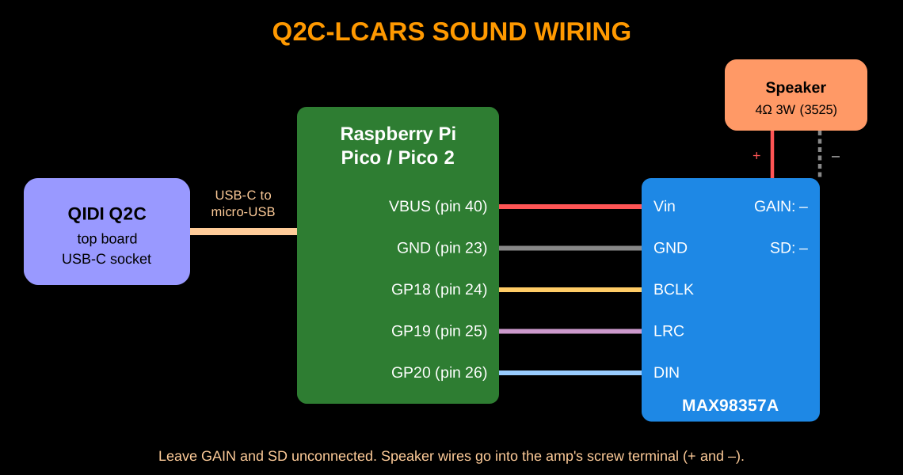

# Q2C-LCARS Sound Board

The QIDI Q2C has no sound card, and its Linux system has no USB audio driver, so USB sound
adapters don't work. This board gets around that. A Raspberry Pi Pico plugs into the
printer's USB-C socket and shows up as a serial device, which the printer *does* have a
driver for. HelixScreen sends it each note, and the Pico plays it through a small I²S
amplifier and speaker.

Nothing on the printer's system is changed, so QIDI firmware updates don't affect it.



## Parts

| Part | Notes | Where | Approx. |
|---|---|---|---|
| Raspberry Pi Pico 2 (or original Pico) | Either works; firmware for both is below | [The Pi Hut](https://thepihut.com/collections/pico/products/raspberry-pi-pico-2) | £4.80 |
| Header pins for the Pico | Not needed if you buy a "with headers" Pico | The Pi Hut, "Male Header Set for Raspberry Pi Pico" | £1 |
| USB-C to micro-USB cable, 50cm | Must carry data, not charge-only | [The Pi Hut](https://thepihut.com/products/usb-c-to-micro-usb-cable-black) | £2.50 |
| MAX98357A I²S 3W amplifier board | Pins: LRC, BCLK, DIN, GAIN, SD, GND, Vin | AliExpress, search "MAX98357A I2S" | £1–2 |
| Speaker, 4Ω 3W (3525 size, "4R 3W 2.0") | 35×25mm enclosed. Cut the plug off and strip the wires | [AliExpress](https://www.aliexpress.com/item/1005004782990430.html) | £1–2 for 2 |
| Female-to-female jumper wires | Five needed | Any | – |

Alternative speaker: The Pi Hut's [Mono Enclosed Speaker with Plain Wires, 3W 4 Ohm](https://thepihut.com/products/mono-enclosed-speaker-with-plain-wires-3w-4-ohm)
(£3.90) is larger (71×30mm) and louder.

## Wiring

| Pico pin | Amp pin |
|---|---|
| VBUS (pin 40) | Vin |
| GND (pin 23) | GND |
| GP18 (pin 24) | BCLK |
| GP19 (pin 25) | LRC |
| GP20 (pin 26) | DIN |
| – | GAIN: leave unconnected (9 dB) |
| – | SD: leave unconnected (on, mixes left + right) |

Speaker wires go into the amp's screw terminal, red to **+**.

Solder the header pins onto the Pico and the amp first. The amp's blue screw terminal also
needs soldering on.

## Flashing the Pico

1. Hold the **BOOTSEL** button on the Pico and plug it into your PC. It appears as a USB drive
   (`RPI-RP2` or `RP2350`).
2. Copy the firmware file onto it:
   - Pico 2: [`firmware/q2c_lcars_sound-pico2.uf2`](firmware/q2c_lcars_sound-pico2.uf2)
   - Original Pico: [`firmware/q2c_lcars_sound-pico.uf2`](firmware/q2c_lcars_sound-pico.uf2)
3. The Pico restarts by itself. If the amp and speaker are wired up, it plays a short
   **two-note chirp** every time it powers on. That's the wiring check.

## Fitting it to the printer

1. Switch the printer off.
2. Plug the cable into the USB-C socket on the left end of the top (Linux) board, and into the Pico.
3. Mount the Pico, amp and speaker away from moving parts and the mains power supply. A spot
   behind the screen works well. Tie the cable down so it can't pull on the socket.
4. Switch on. You should hear the power-on chirp.
5. Check the printer sees it: `ls /dev/serial/by-id/` should list an entry containing
   `Q2C-LCARS_Sound`.

HelixScreen picks it up automatically at start-up and uses it for all sounds. The LCARS
System setting chooses the matching sound set (24th Century chirps or 25th Century tones).

## Testing from the command line

With HelixScreen stopped, you can drive the board by hand from the printer:

```bash
PORT=$(ls /dev/serial/by-id/*Q2C-LCARS_Sound*)
stty -F "$PORT" raw
printf 'T 1480 0.5 2\n' > "$PORT"; sleep 0.2; printf 'S\n' > "$PORT"
```

## Protocol

One ASCII line per change:

| Line | Meaning |
|---|---|
| `T <hz> <amp> <wave>` | Play a tone. Amplitude 0–1; wave 0 square, 1 saw, 2 triangle, 3 sine |
| `S` | Silence |
| `V <0-100>` | Master volume (default 60) |
| `?` | Replies `Q2C-LCARS-SOUND 1` |

A tone left on with no messages for 3 seconds stops by itself.

## Building the firmware

```bash
export PICO_SDK_PATH=/path/to/pico-sdk   # tested with SDK 2.1.1
cmake -S q2c_lcars_sound -B build -DPICO_BOARD=pico2   # or pico
cmake --build build
```
